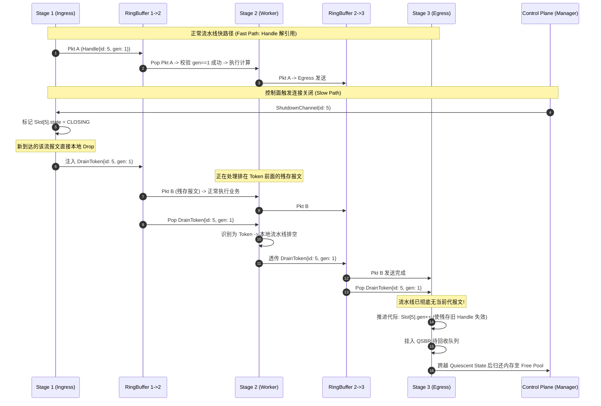
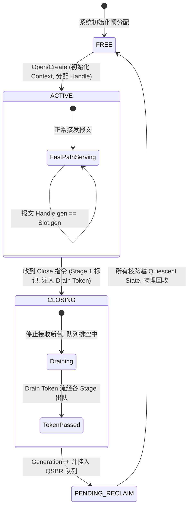

# 高性能通信流水线中的无锁动态生命周期安全机制
> **文档定位**：高吞吐数据面（DPDK / 电信网关 / 高并发代理）架构设计规范  
> **核心议题**：多线程无锁队列流水线中报文转发（Fast Path）与 Channel/Session 动态销毁（Slow Path）的安全并发，彻底避免 UAF (Use-After-Free) 与 Cache-line Bouncing。

---

## 目录
- [一、 痛点剖析与本质矛盾](#一-痛点剖析与本质矛盾)
  - [1.1 核心矛盾](#11-核心矛盾)
  - [1.2 为什么传统方案在此失效？](#12-为什么传统方案在此失效)
- [二、 业界顶级通信框架/数据面主流解法对比](#二-业界顶级通信框架数据面主流解法对比)
  - [2.1 主流技术路线分析](#21-主流技术路线分析)
  - [2.2 多维决策对比矩阵](#22-多维决策对比矩阵)
- [三、 最优架构选型：Drain Barrier + Generation Slot + QSBR 混合模型](#三-最优架构选型drain-barrier--generation-slot--qsbr-混合模型)
  - [3.1 架构三核心支柱](#31-架构三核心支柱)
  - [3.2 系统架构拓扑图](#32-系统架构拓扑图)
- [四、 交互时序与生命周期状态机](#四-交互时序与生命周期状态机)
  - [4.1 正常转发与并发关闭时序图](#41-正常转发与并发关闭时序图)
  - [4.2 Channel 槽位状态转移机](#42-channel-槽位状态转移机)
- [五、 生产级 C++20 / DPDK 风格完整实现伪代码](#五-生产级-c20--dpdk-风格完整实现伪代码)
  - [5.1 核心数据结构定义](#51-核心数据结构定义)
  - [5.2 快路径（Fast Path）：Worker 批量解引用与消费](#52-快路径fast-pathworker-批量解引用与消费)
  - [5.3 慢路径（Slow Path）：发起关闭与注入排空屏障](#53-慢路径slow-path发起关闭与注入排空屏障)
  - [5.4 终点站（Stage N）：排空判定与 QSBR 延迟安全回收](#54-终点站stage-n排空判定与-qsbr-延迟安全回收)
- [六、 复杂拓扑（Fan-out / MPMC）下的屏障汇聚机制](#六-复杂拓扑fan-out--mpmc下的屏障汇聚机制)
- [七、 生产级避坑指南与极限调优](#七-生产级避坑指南与极限调优)

---

## 一、 痛点剖析与本质矛盾

### 1.1 核心矛盾

在一个典型的数据面流水线架构中：
```
[ Stage 1: Ingress / Rx ] ──(RingBuffer 1)──> [ Stage 2: Worker / Logic ] ──(RingBuffer 2)──> [ Stage 3: Egress / Tx ]
```
- **快路径（Fast Path）极致性能诉求**：单核吞吐达千万级 PPS（即单报文处理延迟必须控制在 $\le 100\text{ns}$）。此路径下严禁使用互斥锁、读写锁，甚至要竭力规避跨核原子变量写操作。
- **慢路径（Slow Path）动态生命周期**：Channel/Session 是动态创建和销毁的。某一时刻控制线程触发 `Channel->Close()` 并释放内存，但流水线中可能仍有该 Channel 的 In-flight 报文正在排队或被解引用。

```
[ Stage 1: Ingress ]               [ Stage 2: Worker ]                 [ Stage 3: Egress ]
        │                                  │                                   │
   解析报文得到                           报文在 RingBuffer 排队              发送完成
  Channel* 指针                          或 Worker 正在栈中解引用                │
        │                                  │                                   │
        └──────────────── 此时外部线程触发 ──────────────────────────────────┘
                          Channel->Shutdown() & free()!
                          ===> 触发 Use-After-Free (UAF) / 内存悬挂崩溃!
```

### 1.2 为什么传统方案在此失效？

1. **跨核原子引用计数（`std::atomic<uint32_t> ref_cnt`）的性能灾难**：
   - 若报文在 Stage 1 做 `ref_cnt.fetch_add(1)`，在 Stage 3 做 `ref_cnt.fetch_sub(1)`。
   - 由于 Stage 1 与 Stage 3 运行在不同物理 CPU 核上，每次操作都会触发跨核 MESI 缓存失效协议（Read-for-Ownership），引发严重的 **Cache Line Bouncing（缓存行颠簸）**。
   - 在 10M PPS 负荷下，总线争用会导致 CPU 流水线彻底停顿（Stall），吞吐量暴跌 70% 以上。
2. **ABA 与槽位复用风险**：
   - 若通道刚释放就立即复用内存分配给新连接，下游滞留的旧报文解引用时，将静默读写新通道的数据，造成严重的数据越权篡改与协议解析错误。

---

## 二、 业界顶级通信框架/数据面主流解法对比

### 2.1 主流技术路线分析

1. **RCU (Read-Copy Update) / QSBR (Quiescent-State-Based Reclamation)**:
   - *代表*：Linux 内核、DPDK (`rte_rcu_qsbr`)、Userspace RCU。
   - *机制*：读者零锁访问；写者更新后等待所有读者走过“静止点”（Grace Period）再物理释放。
   - *局限*：在跨线程流水线中，报文在 Ring Buffer 排队的时间无法简单折算为单个线程的局部 RCU 临界区。若一个报文在队列中排队，无法阻止外部 RCU 推进。
2. **Drain Barrier / Flush Token（排空屏障 / 流水线标记）**:
   - *代表*：VPP (FD.io)、Netty ChannelPipeline、硬件 DMA/GPU 指令队列。
   - *机制*：利用 Ring Buffer 严格 FIFO 的物理属性。关闭时向流水线注入特殊 Token，Token 后的所有报文必然不属于该通道；当 Token 离开流水线末端时，数学上证明流水线内无残存报文。
   - *评价*：快路径零额外同步开销，最契合多 Stage 流水线。
3. **Thread-per-core / Shared-Nothing（无共享 / Run-to-Completion）**:
   - *代表*：Seastar、Envoy、DPDK RSS 模式。
   - *机制*：放弃多线程流水线，改为单核全流程（Rx -> Logic -> Tx）。连接严格绑定到特定核，生命周期管理纯核内完成。
   - *局限*：无法应对计算量极不均衡的流水线异构调度需求（例如 Stage 2 需要耗费大量 CPU 进行加解密或深度报文检查）。
4. **Per-CPU 引用计数（`percpu_ref`）**:
   - *代表*：Linux 内核 `percpu_ref`、eBPF Map。
   - *机制*：正常时各核读写独立的 Per-CPU Counter；销毁时切入原子模式汇总归零。
   - *局限*：快路径每包仍需单核写指令（虽然没有跨核争用，但消耗执行单元）；状态切换需要全局内存屏障或 IPI 中断。
5. **Hazard Pointers (HP)**:
   - *代表*：Folly `Hazptr`、ConcurrencyKit。
   - *局限*：读者必须在访问前向槽位发布指针，且必须执行昂贵的带总线锁屏障（`seq_cst` 或 `mfence`，消耗 30~50 周期），**完全不适合千万级 PPS 的数据面**。

### 2.2 多维决策对比矩阵

| 评估维度 | RCU / QSBR | Drain Barrier (排空屏障) | Thread-per-core | Per-CPU Refcount | Hazard Pointers |
| :--- | :--- | :--- | :--- | :--- | :--- |
| **快路径读开销** | 极低（读无锁） | **零开销（类型匹配）** | 绝对零开销 | 低（本地写） | 极高（`mfence`） |
| **跨核原子写争用** | 无 | **无** | 无 | 关闭时有一次性开销 | 频繁 |
| **流水线模型契合度** | 中（需改造） | **极高（天然 FIFO）** | 差（需重构成 RTC） | 中 | 差 |
| **内存回收确定性** | 依赖 Grace Period | **确定（Token 出队即排空）** | 确定（即时销毁） | 确定（归零即释放） | 极高（即时） |
| **实现复杂度** | 中等 | **低~中** | 架构级重构 | 高 | 中高 |

---

## 三、 最优架构选型：Drain Barrier + Generation Slot + QSBR 混合模型

### 3.1 架构三核心支柱

针对“多线程无锁队列流水线”，业界最佳落地实践为三者协同：

1. **Generation Slot Allocator（代际槽位句柄）—— 解决野指针与 ABA**：
   - 报文在流水线中**严禁传递原始指针 `Channel*`**，仅传递轻量级 64-bit 句柄 `ChannelHandle { uint32_t slot_id; uint32_t generation; }`。
   - 内存预分配定长数组，解引用时校验：`Slot[slot_id].gen == handle.gen`。即使通道已关闭或被复用，校验失败立即丢包，绝不发生非法内存访问。
2. **Drain Barrier Token（排空屏障）—— 解决 In-flight 报文确定性清空**：
   - 关闭通道时，Stage 1 标记通道状态为 `CLOSING`（后续新包直接丢弃）。
   - 向 Ring Buffer 压入一个特殊的 `DrainToken { slot_id, gen }`。
   - 依赖无锁环形队列的 FIFO 属性：**排在 Token 之前的报文正常消费，排在 Token 之后的报文不可能含有该 Channel 数据**。
3. **QSBR 延迟安全释放（QSBR Quarantine Pool）—— 解决寄存器瞬态解引用**：
   - 当 Token 离开 Stage N 时，证明队列已无滞留报文。但某个 Worker 线程可能在出队瞬间将指针取至 CPU 局部寄存器中运算。
   - 因此将槽位挂入本核的延迟回收队列，待 Worker 走完当前 Batch（Burst）的静止点后，物理归还对象池。

### 3.2 系统架构拓扑图

```
                       ┌────────────────────────────────────────────────────────┐
                       │               Global Slot Control Table                │
                       │    [Slot 0]  [Slot 1] ... [Slot id (gen=k)] ... [Slot N]│
                       └────────────────────────────────────────────────────────┘
                                                    ▲
                                                    │ 报文仅带 Handle (SlotID + Gen)
                                                    │ $O(1)$ 无锁读取校验
                                                    │
┌──────────────────┐    Lock-Free Ring 1    ┌──────────────────┐    Lock-Free Ring 2    ┌──────────────────┐
│ Stage 1: Ingress │ ══════════════════════> │ Stage 2: Worker  │ ══════════════════════> │ Stage 3: Egress  │
│                  │                         │                  │                         │                  │
│ [State->CLOSING] │                         │ (FIFO 保序转发)   │                         │ [Token 出队触发] │
│ [Inject Token]   │ ── DrainToken{id,k} ──> │                  │ ── DrainToken{id,k} ──> │ [推进代际 gen++] │
└──────────────────┘                         └──────────────────┘                         └────────┬─────────┘
                                                                                                   │
                                                                                                   ▼
                                                                                         ┌──────────────────┐
                                                                                         │ QSBR 待回收队列   │
                                                                                         │ (跨越 Epoch 后释放)│
                                                                                         └──────────────────┘
```

---

## 四、 交互时序与生命周期状态机

### 4.1 正常转发与并发关闭时序图



### 4.2 Channel 槽位状态转移机



---

## 五、 生产级 C++20 / DPDK 风格完整实现伪代码

### 5.1 核心数据结构定义

```cpp
#include <atomic>
#include <cstdint>
#include <cstddef>
#include <array>
#include <immintrin>

// 1. 句柄：64-bit 结构，可随 mbuf 直接值传递（Cache 友好）
struct ChannelHandle {
    uint32_t slot_id;
    uint32_t generation;

    bool operator==(const ChannelHandle&) const = default;
};

// 2. 消息分类：报文与屏障统一封装
enum class MsgType : uint8_t {
    PACKET,
    DRAIN_TOKEN
};

struct PipelineMsg {
    MsgType type;
    ChannelHandle handle;
    void* pkt_payload; // 指向实际报文数据（如 rte_mbuf）
};

// 3. 通道状态
enum class ChannelState : uint8_t {
    FREE,
    ACTIVE,
    CLOSING
};

// 4. 通道槽位控制块（强制对齐到 64 字节 Cache-line，避免 False Sharing）
struct alignas(64) ChannelControlBlock {
    std::atomic<uint32_t> generation{1};
    std::atomic<ChannelState> state{ChannelState::FREE};
    
    // 实际业务 Session 结构
    void* session_context{nullptr};
};

// 全局静态预分配定长 Slot 表
constexpr size_t MAX_CHANNELS = 65536;
static std::array<ChannelControlBlock, MAX_CHANNELS> g_channel_table;
```

### 5.2 快路径（Fast Path）：Worker 批量解引用与消费

```cpp
// Stage 2 Worker 的 Batch (Burst) 处理主循环
template <typename NextQueue>
void stage2_worker_process_burst(PipelineMsg* batch, size_t count, NextQueue& next_stage_queue) {
    for (size_t i = 0; i < count; ++i) {
        PipelineMsg& msg = batch[i];

        if (__builtin_expect(msg.type == MsgType::PACKET, 1)) {
            // ──────────────── FAST PATH ────────────────
            auto& ccb = g_channel_table[msg.handle.slot_id];

            // 1. 代际校验（无跨核写争用，X86 下 acquire 退化为普通读指令 mov）
            uint32_t cur_gen = ccb.generation.load(std::memory_order_acquire);
            if (__builtin_expect(cur_gen == msg.handle.generation, 1)) {
                // 安全解引用：代际匹配，且排空机制确保此时不会被物理销毁
                do_business_processing(ccb.session_context, msg.pkt_payload);
                next_stage_queue.enqueue(msg);
            } else {
                // 晚到的过期报文，直接静默丢弃
                drop_packet(msg.pkt_payload);
            }
        } 
        else if (__builtin_expect(msg.type == MsgType::DRAIN_TOKEN, 0)) {
            // ──────────────── DRAIN BARRIER ────────────────
            // FIFO 保证本 Worker 队列前序报文均已处理完毕
            flush_worker_local_cache(msg.handle.slot_id);
            // 将 Token 原样推向下一 Stage
            while (!next_stage_queue.enqueue(msg)) {
                _mm_pause(); // 慢路径保序，必须推入成功
            }
        }
    }
}
```

### 5.3 慢路径（Slow Path）：发起关闭与注入排空屏障

```cpp
template <typename FirstQueue>
void initiate_channel_shutdown(uint32_t slot_id, FirstQueue& stage1_to_stage2_q) {
    auto& ccb = g_channel_table[slot_id];
    
    // 1. 标记为 CLOSING，Stage 1 收到新外来报文直接拒绝/丢弃
    ccb.state.store(ChannelState::CLOSING, std::memory_order_release);

    uint32_t cur_gen = ccb.generation.load(std::memory_order_relaxed);

    // 2. 构造并向流水线注入 Drain Token
    PipelineMsg token {
        .type = MsgType::DRAIN_TOKEN,
        .handle = ChannelHandle{.slot_id = slot_id, .generation = cur_gen},
        .pkt_payload = nullptr
    };

    while (!stage1_to_stage2_q.enqueue(token)) {
        _mm_pause();
    }
}
```

### 5.4 终点站（Stage N）：排空判定与 QSBR 延迟安全回收

```cpp
struct PendingFreeEntry {
    uint32_t slot_id;
    uint32_t generation;
    uint64_t epoch_snapshot;
};

// Stage N 处理出队的 Drain Token
template <typename PendingRing>
void stage_n_handle_drain_token(const PipelineMsg& token, 
                                PendingRing& deferred_free_ring,
                                uint64_t current_qsbr_epoch) {
    auto& ccb = g_channel_table[token.handle.slot_id];
    
    // 1. 全流水线已无残存报文，推进 generation 使任何外部持有者的 Handle 失效
    ccb.generation.fetch_add(1, std::memory_order_release);
    
    // 2. 挂入延迟释放队列（等待所有核走过当前静止周期，兜底瞬态寄存器引用）
    deferred_free_ring.enqueue(PendingFreeEntry{
        .slot_id = token.handle.slot_id,
        .generation = token.handle.generation,
        .epoch_snapshot = current_qsbr_epoch
    });
}

// 周期性（如每处理 1024 个报文）检查 QSBR 静止点并归还内存
template <typename PendingRing, typename QSBRModule>
void try_reclaim_pending_channels(PendingRing& deferred_ring, QSBRModule& qsbr) {
    PendingFreeEntry entry;
    while (deferred_ring.peek(entry)) {
        if (qsbr.check_all_cores_quiescent(entry.epoch_snapshot)) {
            deferred_ring.dequeue(entry);
            
            // 3. 物理释放底层资源，重置状态
            auto& ccb = g_channel_table[entry.slot_id];
            free_session_context(ccb.session_context);
            ccb.session_context = nullptr;
            ccb.state.store(ChannelState::FREE, std::memory_order_release);
        } else {
            break; // FIFO 特性，队首未完成，后续不予处理
        }
    }
}
```

---

## 六、 复杂拓扑（Fan-out / MPMC）下的屏障汇聚机制

若流水线存在分流架构（如 Stage 1 通过哈希将报文分发给 $K$ 个并行的 Worker 线程）：

```
                     ┌──> [ Worker Core 0 ] ──┐
                     ├──> [ Worker Core 1 ] ──┤
[ Ingress Core ] ────┼──> [ Worker Core 2 ] ──┼───> [ Aggregator / Egress ]
                     └──> [ Worker Core K ] ──┘
```

此时的排空屏障采用 **Barrier Aggregation（屏障计数汇聚）** 机制：
1. **多路广播**：Stage 1 触发关闭时，向所有 $K$ 个 Worker 队列**各自广播一个相同的 Drain Token**。
2. **汇聚计数器**：在控制块中初始化 `std::atomic<uint32_t> pending_tokens{K}`。
3. **汇聚判定**：每个 Worker 处理完自己队列中的 Token 后，原子执行 `pending_tokens.fetch_sub(1, std::memory_order_acq_rel)`。
4. **触发回收**：当且仅当最后一个 Token 离开（计数归零）时，确认所有并行分支的 FIFO 队列均已清空，触发 Stage N 代际推进与 QSBR 延迟释放。

---

## 七、 生产级避坑指南与极限调优

1. **绝对禁止在 Burst 溢出时丢弃 Drain Token**：
   - 数据面批量入队（`enqueue_burst`）在队列满时通常会丢弃报文。
   - **规则**：普通报文丢弃仅计入统计，但 **Drain Token 绝不可丢弃**！如果入队失败，必须自旋重试或暂存到溢出缓冲区（Spillover Buffer），否则会导致 Channel 永远无法触发释放。
2. **消除伪共享（False Sharing）**：
   - `ChannelControlBlock` 必须以 `alignas(64)` 或 `alignas(128)` 隔离。
   - 避免将控制状态（`state`、`generation`）与可能高频统计的字段（如 `rx_bytes`）放在同一缓存行。
3. **内存屏障开销最小化**：
   - 快路径中仅对 `generation` 使用 `memory_order_acquire`，X86 架构下此操作成本等同于裸读，无总线锁开销。
   - 慢路径写状态采用 `memory_order_release`。严禁在快路径使用全局开销巨大的 `memory_order_seq_cst`。
4. **长尾滞留与 Generation Watchdog 保护**：
   - 极少数情况下 Worker 发生故障或停顿导致 Token 滞留过久。
   - 生产环境中建议引入 Watchdog：若 Channel 处于 `CLOSING` 状态超过阈值（如 5s），强制告警并隔离槽位，防止 Slot 资源耗尽。
