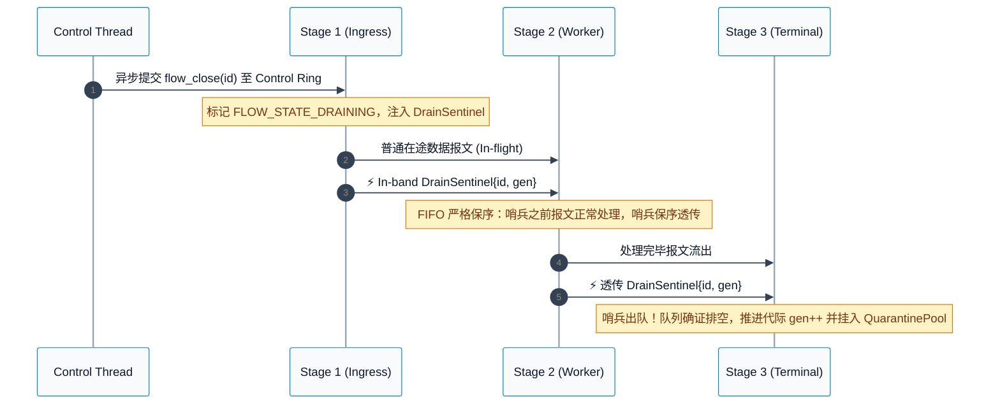
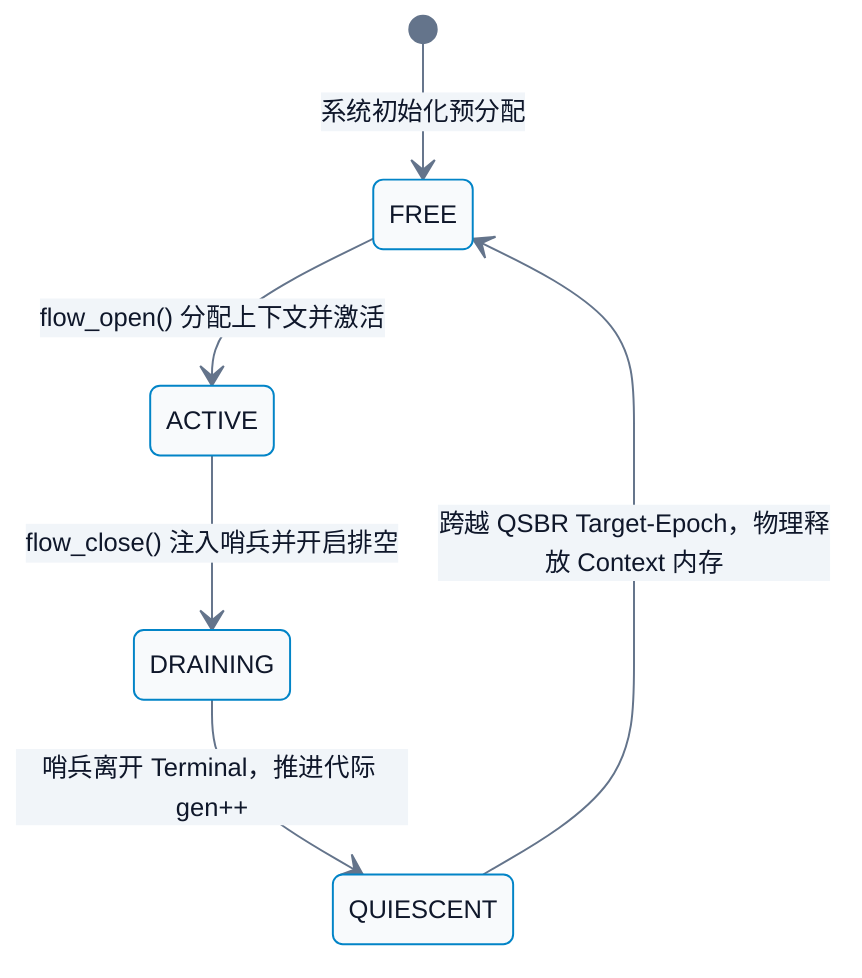

# 高性能通信流水线中的无锁动态生命周期安全机制
> **定位与目标**：高吞吐数据面（DPDK、电信网关、高性能反向代理）无锁多 Stage 流水线架构设计规范。  
> **核心痛点**：单报文时延预算 $\le 100\text{ns}$ 时，Fast Path（10M+ PPS 转发）与 Slow Path（动态连接销毁与内存释放）交汇引发的 UAF、ABA 槽位复用污染以及 Cache Line Bouncing 崩溃。

---

## 目录
- [一、 痛点背景与本质矛盾](#一-痛点背景与本质矛盾)
- [二、 业界主流解法与权衡对比](#二-业界主流解法与权衡对比)
- [三、 核心架构设计与时序图解](#三-核心架构设计与时序图解)
- [四、 工业级代码实战与关键落地](#四-工业级代码实战与关键落地)
- [五、 生产级避坑指南与极限调优](#五-生产级避坑指南与极限调优)
- [六、 认知更新与自我拷问 (Self-Grilling)](#六-认知更新与自我拷问-self-grilling)

---

## 一、 痛点背景与本质矛盾

### 1.1 时空错位与并发车祸现场

在基于多 Stage 跨核流水线的高性能通信数据面中，不同阶段由专有物理核心（Core）独立运行，核心间通过单向无锁 SPSC Ring Buffer 传递报文消息：

```
+────────────────────+       +────────────────────+       +────────────────────+
|  Stage 1: Ingress  |       |  Stage 2: Worker   |       | Stage 3: Terminal  |
+────────────────────+       +────────────────────+       +────────────────────+
          |                            |                            |
   Parse packet to              Packet in RingBuffer         Egress complete
      FlowHandle                or Worker in register               |
          |                            |                            |
          +────────────────────────────+────────────────────────────+
                                       ^
                        External control thread triggers:
                             flow_close() & free()!
                        ===> Concurrent UAF / Memory Crash
```

1. **Fast Path 纳秒级吞吐**：单核千万级 PPS 意味着单包处理窗口不足 $100\text{ns}$。各 Stage 严禁任何互斥锁、读写锁，且必须极力避免跨核原子写争用。
2. **Slow Path 动态连接拆除**：网络连接按需建立与关闭。控制线程销毁流并物理释放 `FlowContext` 的时刻，下游 Ring Buffer 传送带上极可能仍滞留着排队中的在途报文。若 Worker 出队后直接解引用悬挂指针，将瞬间触发严重的 UAF 或非法踩内存崩溃。

### 1.2 为什么传统直觉方案在此全部失效？

在严苛的数据面约束下，常规并发方案均存在致命短板：

1. **跨核原子引用计数引发性能雪崩**：
   - *直觉解法*：Stage 1 收到报文执行 `atomic_fetch_add(&ref_cnt, 1)`，Stage 3 发送完毕执行 `atomic_fetch_sub(&ref_cnt, 1)`。
   - *致命缺陷*：Stage 1 与 Stage 3 绑定在不同物理核心。跨核写同一个 Cache Line 会频繁触发 MESI 协议的 **RFO** 广播，引发惨烈的 **Cache Line Bouncing**。千万级 PPS 下总线仲裁被打满，CPU 流水线停顿（Stall），吞吐暴跌 70% 以上。
2. **槽位过早复用引发的 ABA 业务串流**：
   - 若流注销后立即将 Slot 分配给新握手的连接，队列中滞留的旧报文出队解引用时，将静默读写新连接的上下文。这不会产生崩溃，但会导致致命的业务串流与数据越权篡改。

---

## 二、 业界主流解法与权衡对比

### 2.1 经典无锁回收方案在流水线下的困境

1. **Hazard Pointers**：
   - *机制*：读者线程在访问上下文内存前，向全局公告牌写入正在访问的指针值。
   - *流水线缺陷*：为保证写可见性，读者每次解引用前必须执行硬件全内存屏障（如 x86 的 `mfence` 或 C11 的 `seq_cst`），单包开销增加 30~50 CPU 周期，Fast Path 吞吐直接腰斩。
2. **RCU / QSBR**：
   - *机制*：读者零锁零开销读指针；回收器等待所有工作线程穿过静止点 Quiescent State 后再物理释放内存。
   - *流水线缺陷*：跨核 Ring Buffer 的存在**打破了 Quiescent State 的时空同步**。即便所有 Worker 核心都走过了 Quiescent State，FIFO 队列传送带上依然可能滞留着毫秒前入队、正排队等待处理的残存报文。若仅靠传统 QSBR 提前释放内存，排队报文出队解引用依然引发 UAF。
3. **Thread-per-core / Shared-Nothing**：
   - *机制*：放弃跨核流水线，单核独立闭环 Rx -> Worker -> Tx。
   - *局限*：无法应对异构算力倾斜。当业务层需要进行重量级加解密或 DPI 时，单核算力被击穿，无法按 Stage 进行弹性伸缩。
4. **Drain Barrier Protocol**：
   - *机制*：利用 Ring Buffer 严格单向 FIFO 属性。控制面注销流时，Stage 1 向队列注入一个轻量级 `DrainSentinel`。排在哨兵之前的旧报文正常消费，哨兵之后到达的报文直接本地丢弃。当该哨兵穿透至最后一级流水线出队时，数学上证明**整个流水线队列中已绝无该流的残存报文**。

### 2.2 多维决策对比矩阵

| 评估维度 | Hazard Pointers | 传统 RCU / QSBR | Thread-per-core | Drain Barrier + QSBR (本文选型) |
| :--- | :--- | :--- | :--- | :--- |
| **Fast Path 开销** | 极高（包包 `mfence`） | 极低（纯读无锁） | 绝对零开销 | **零额外开销（Acquire Load 校验）** |
| **跨核总线争用** | 极高（跨核可见写） | 无 | 无 | **无（单核独占写与无锁读）** |
| **流水线契合度** | 差 | 差（队列延迟打破 QS 假定）| 极差（排斥流水线）| **极高（契合单向保序 FIFO）** |
| **内存回收确定性** | 极高（即时物理释放） | 滞后（依赖 Grace Period） | 极高（即时物理释放） | **确定（哨兵出队即保证队列清空）** |
| **算力异构扩展性** | 好 | 好 | 极差（单核易成热点） | **极好（各 Stage 独立扩缩容）** |

---

## 三、 核心架构设计与时序图解

### 3.1 核心设计哲学：双平面纵深防御

单一机制无法覆盖所有内存危险边界。本架构确立由 **Generational Handle + Drain Barrier Protocol + Dense Generation Array + QSBR Quarantine** 构成的双平面纵深防御体系：

- **数据平面内部（In-band Defense）**：
  - **防线 1（Generational Handle）**：报文严禁传递裸指针，仅携带 64-bit 紧凑句柄 `{flow_id, generation}`。Worker 仅需一次单核本地的 O(1) 代际比对，代际不符瞬间本地丢弃，物理阻断 UAF 与 ABA 越权。
  - **防线 2（Drain Barrier Protocol）**：流关闭时，Ingress 注入不可丢弃的 `DrainSentinel`。利用 SPSC 队列的 FIFO 物理保序性，当且仅当哨兵从 Terminal Stage 出队时，数学上确证流水线队列内已无当前代在途报文。
- **控制与带外平面（Out-of-band Defense）**：
  - **防线 3（QSBR Quarantine Pool）**：哨兵出队后，Terminal 执行代际递增并挂入 QuarantinePool。QSBR 的真正职责是防范**带外非保序并发访问**（如控制面定时器扫描流表、全局流统计审计、以及跨核无锁哈希桶遍历）。通过 Target-Epoch 屏障，确保带外读者完全退出后，物理释放 `FlowContext`。

```
                                    +────────────────────────────────────────+
                                    |      Dense Generation Array (Hot)      |
                                    | [Gen 0] [Gen 1] ... [Gen K] ... [Gen N]|
                                    +────────────────────────────────────────+
                                                        ^
                                                        | O(1) Acquire Load
                                                        | Table[id].gen == handle.gen
                                                        |
+──────────────────+      Lock-Free Ring 1     +──────────────────+      Lock-Free Ring 2     +──────────────────+
| Stage 1: Ingress | ========================> | Stage 2: Worker  | ========================> | Stage 3: Terminal|
|                  |                           |                  |                           |                  |
| [State->DRAINING]|                           | (FIFO Forward)   |                           | [Sentinel Out]   |
| [Inject Sentinel]| ── DrainSentinel{id,k} ─> |                  | ── DrainSentinel{id,k} ─> | [Advance gen++]  |
+──────────────────+                           +──────────────────+                           +─────────┬────────+
                                                                                                        |
                                                                                                        v
                                                                                              +──────────────────+
                                                                                              |  QuarantinePool  |
                                                                                              | (Target-Epoch)   |
                                                                                              +──────────────────+
```

### 3.2 交互时序与状态机

#### 排空时序图



#### Flow 槽位状态转移机



### 3.3 硬件内存排布规范

#### 1. 流表冷热分离与 Dense Generation Array
为规避单条 FCB 膨胀至 64B 导致的 L1/L2 缓存雪崩，架构采用冷热分离布局：
- **热表（Dense Generation Array）**：仅存储 4 字节的代际计数器，一条 64B Cache Line 高密度容纳 16 条流，大幅提升硬件预取效率；
- **冷表（FlowColdContext）**：存储写频次极低的状态位与上下文指针，严格按 64 字节对齐并填充，杜绝慢路径写操作引发的 False Sharing。

```
+──────────────────── Dense Generation Array (64 Bytes) ────────────────────+
| gen 0 | gen 1 | gen 2 | gen 3 |  ...  | gen 12 | gen 13 | gen 14 | gen 15 |
|  (4B) |  (4B) |  (4B) |  (4B) |  ...  |  (4B)  |  (4B)  |  (4B)  |  (4B)  |
+───────+───────+───────+───────+───────+────────+────────+────────+────────+
|<─────────────────────────── Cache Line (64B) ────────────────────────────>|

+──────────────────────── FlowColdContext (64 Bytes) ───────────────────────+
| state (4B) | rsvd (4B) |   flow_context* (8B)   |        pad (48B)        |
+────────────+───────────+────────────────────────+─────────────────────────+
|<─────────────────────────── Cache Line (64B) ────────────────────────────>|
```

#### 2. Pipeline Message Envelope (32 Bytes Half-Cache-Line)
队列传递统一紧凑的 32 字节信封，一条 64B Cache Line 严丝合缝对齐容纳 2 个信封，物理上杜绝 Cache Line Split 惩罚：

```
+────────────────────────────────── PipelineMsg (32 Bytes) ──────────────────────────+
| 0            3 | 4            7 | 8           11 | 12          15 | 16          31 |
| type / flags   |    flow_id     |   generation   |   flow_hash    |     Payload    |
+────────────────+────────────────+────────────────+────────────────+────────────────+
| [Packet Mode]                   | pkt_payload (8B)                | len/qid/rsv(8B)|
| [Sentinel Mode]                 | sentinel_seq (8B)               | barrier_ack(8B)|
+─────────────────────────────────+─────────────────────────────────+────────────────+
|<────────────────────────────── Half Cache Line (32B) ─────────────────────────────>|
```

---

## 四、 工业级代码实战与关键落地

### 4.1 模块 1：Dense Generation Array 与 Fast Path 校验

```c
#include <stdint.h>
#include <stdbool.h>
#include <stdatomic.h>
#include <stdalign.h>
#include <assert.h>

#define MAX_FLOWS 1024

/*
 * Section: Dense Generation Array (Hot Table) & FlowColdContext (Cold Table)
 *
 * Invariants:
 *   - Fast-path validation only inspects `g_flow_gen[flow_id]`.
 *   - Packing 16 generations into a 64B cache line maximizes L1/L2 spatial locality.
 *   - Writers bump `generation` using memory_order_release; readers execute
 *     an acquire load, forming a synchronized-with relationship that publishes
 *     all previous flow context updates.
 */
typedef struct {
    atomic_uint generation;
} FlowGenerationEntry;

static_assert(sizeof(FlowGenerationEntry) == 4,
              "FlowGenerationEntry must be 4 bytes");

typedef struct {
    alignas(64) atomic_uint state;
    uint32_t                rsvd;
    void                   *flow_context;
    uint8_t                 pad[48];
} __attribute__((aligned(64))) FlowColdContext;

static_assert(sizeof(FlowColdContext) == 64,
              "FlowColdContext must occupy exactly one cache line");

static FlowGenerationEntry g_flow_gen[MAX_FLOWS];
static FlowColdContext     g_flow_cold[MAX_FLOWS];

static inline uint32_t flow_get_generation(uint32_t flow_id) {
    assert(flow_id < MAX_FLOWS);
    return atomic_load_explicit(&g_flow_gen[flow_id].generation, memory_order_acquire);
}

static inline void *flow_get_context(uint32_t flow_id) {
    assert(flow_id < MAX_FLOWS);
    return g_flow_cold[flow_id].flow_context;
}

static inline void flow_advance_generation(uint32_t flow_id) {
    assert(flow_id < MAX_FLOWS);
    atomic_fetch_add_explicit(&g_flow_gen[flow_id].generation, 1, memory_order_release);
}
```

### 4.2 模块 2：3 Cache Lines 物理隔离 SPSC RingBuffer

```c
/*
 * Section: SPSC Lock-Free Ring Buffer with Shadow Cursors
 *
 * Invariants:
 *   - Physical 3-cache-line layout strictly eliminates false sharing:
 *       * prod (offset 0): written solely by Producer
 *       * cons (offset 64): written solely by Consumer
 *       * meta (offset 128): read-only after initialization
 *   - Shadow cursors (cached_tail / cached_head) cut cross-socket cache coherence
 *     traffic by >90% by amortizing atomic synchronization.
 */
typedef struct {
    struct {
        alignas(64) atomic_size_t head;
        size_t                    cached_tail;
        uint8_t                   pad[64 - sizeof(atomic_size_t) - sizeof(size_t)];
    } prod;

    struct {
        alignas(64) atomic_size_t tail;
        size_t                    cached_head;
        uint8_t                   pad[64 - sizeof(atomic_size_t) - sizeof(size_t)];
    } cons;

    struct {
        alignas(64) size_t   capacity;
        size_t               mask;
        PipelineMsg         *entries;
        uint8_t              pad[64 - 2 * sizeof(size_t) - sizeof(PipelineMsg *)];
    } meta;
} __attribute__((aligned(64))) RingBuffer;

static_assert(sizeof(RingBuffer) == 192,
              "RingBuffer must be exactly 192 bytes (3 cache lines)");

static inline bool ring_buffer_enqueue(RingBuffer *ring, const PipelineMsg *msg) {
    size_t head = atomic_load_explicit(&ring->prod.head, memory_order_relaxed);

    if (head - ring->prod.cached_tail >= ring->meta.capacity) {
        ring->prod.cached_tail = atomic_load_explicit(&ring->cons.tail, memory_order_acquire);
        if (head - ring->prod.cached_tail >= ring->meta.capacity)
            return false;
    }

    ring->meta.entries[head & ring->meta.mask] = *msg;
    atomic_store_explicit(&ring->prod.head, head + 1, memory_order_release);
    return true;
}

static inline bool ring_buffer_dequeue(RingBuffer *ring, PipelineMsg *msg) {
    size_t tail = atomic_load_explicit(&ring->cons.tail, memory_order_relaxed);

    if (tail == ring->cons.cached_head) {
        ring->cons.cached_head = atomic_load_explicit(&ring->prod.head, memory_order_acquire);
        if (tail == ring->cons.cached_head)
            return false;
    }

    *msg = ring->meta.entries[tail & ring->meta.mask];
    atomic_store_explicit(&ring->cons.tail, tail + 1, memory_order_release);
    return true;
}
```

### 4.3 模块 3：Target-Epoch QSBR Quarantine 与带外安全回收

```c
/*
 * Section: Target-Epoch QSBR Reconciliation Loop
 *
 * Invariants:
 *   - Terminal increments global_epoch and snapshots `target_epoch = global_epoch + 1`
 *     upon enqueueing into QuarantineRing.
 *   - Memory reclamation proceeds iff all reader threads announce an epoch >= target_epoch,
 *     strictly guaranteeing at least one full quiescent grace period.
 */
typedef struct {
    uint32_t flow_id;
    uint32_t generation;
    uint64_t target_epoch;
} QuarantineEntry;

static inline uint64_t qsbr_advance_epoch(QSBRModule *q) {
    return atomic_fetch_add_explicit(&q->global_epoch, 1, memory_order_release) + 1;
}

static inline bool qsbr_check_all_quiescent(QSBRModule *q, uint64_t target_epoch) {
    for (uint32_t i = 0; i < q->num_threads; ++i) {
        uint64_t te = atomic_load_explicit(&q->threads[i].epoch, memory_order_acquire);
        if (te < target_epoch)
            return false;
    }
    return true;
}

uint64_t try_reclaim_quarantined_flows(QuarantineRing *ring, QSBRModule *qsbr) {
    uint64_t reclaimed = 0;
    QuarantineEntry entry;

    while (quarantine_ring_peek(ring, &entry)) {
        if (qsbr_check_all_quiescent(qsbr, entry.target_epoch)) {
            quarantine_ring_dequeue(ring, &entry);
            flow_reclaim_context(entry.flow_id);
            reclaimed++;
        } else {
            break;
        }
    }
    return reclaimed;
}
```

### 4.4 配套工程源码索引

仓库提供了完整可运行且通过 ThreadSanitizer 验证的 C11 实验工程：

👉 **代码路径**：[`05-hands-on-labs/05-lockfree-pipeline/`](file:///home/qbl/Documents/CsLearnHub/05-hands-on-labs/05-lockfree-pipeline/)

| 核心组件 | 头文件与源码 | 核心工程设计 |
| :--- | :--- | :--- |
| **Hot/Cold Flow Tables** | [`include/flow.h`](file:///home/qbl/Documents/CsLearnHub/05-hands-on-labs/05-lockfree-pipeline/include/flow.h), [`src/flow.c`](file:///home/qbl/Documents/CsLearnHub/05-hands-on-labs/05-lockfree-pipeline/src/flow.c) | Dense Generation Array（16 流/Cache Line），冷数据 64B 对齐隔离 |
| **SPSC Ring Buffer** | [`include/ring_buffer.h`](file:///home/qbl/Documents/CsLearnHub/05-hands-on-labs/05-lockfree-pipeline/include/ring_buffer.h) | 3 Cache Lines 物理隔离，影子游标消除 90% 总线颠簸 |
| **Message Envelope** | [`include/message.h`](file:///home/qbl/Documents/CsLearnHub/05-hands-on-labs/05-lockfree-pipeline/include/message.h) | 32B 紧凑 Union 信封，零堆内存分配 |
| **Pipeline Driver** | [`include/pipeline.h`](file:///home/qbl/Documents/CsLearnHub/05-hands-on-labs/05-lockfree-pipeline/include/pipeline.h), [`src/pipeline.c`](file:///home/qbl/Documents/CsLearnHub/05-hands-on-labs/05-lockfree-pipeline/src/pipeline.c) | 专有 Control Ring 异步注销，Fast Path 代际校验与哨兵排空 |
| **Target-Epoch QSBR** | [`include/qsbr.h`](file:///home/qbl/Documents/CsLearnHub/05-hands-on-labs/05-lockfree-pipeline/include/qsbr.h), [`src/qsbr.c`](file:///home/qbl/Documents/CsLearnHub/05-hands-on-labs/05-lockfree-pipeline/src/qsbr.c) | 纠正 0 宽 Grace Period 漏洞，Target-Epoch 屏障驱动隔离池回收 |
| **Main & Benchmark** | [`src/main.c`](file:///home/qbl/Documents/CsLearnHub/05-hands-on-labs/05-lockfree-pipeline/src/main.c), [`benchmark.py`](file:///home/qbl/Documents/CsLearnHub/05-hands-on-labs/05-lockfree-pipeline/benchmark.py) | 破除 63 条流限制，支持百万级包量与千流压测及 Linux perf 分析 |

---

## 五、 生产级避坑指南与极限调优

### 5.1 Spillover Buffer 与 Tail-Drop 拥塞优先级
- **核心矛盾**：普通业务数据报文允许有损（Lossy），但 `DrainSentinel` 属于控制信令，绝不可丢弃（Lossless）。若下游 Worker 出现微秒级毛刺导致 Ring 1 满，Ingress 盲目自旋会卡死物理核上所有正常流。
- **最优实践**：
  1. 为 Ingress 分配专有 Spillover Ring 暂存哨兵；
  2. 若 Spillover 队列亦达到高水位，**Ingress 立即主动 Tail-Drop 网卡新收到的普通业务报文**，腾出 Ring 1 槽位注入 Sentinel。以局部业务包丢失为代价，彻底杜绝数据面全核死锁（见 ADR-0004）。

### 5.2 Memory Order 成本极小化与弱内存序防护
- **x86-64 架构**：`memory_order_acquire` 对应普通 `MOV` 指令（硬件 TSO 保障 Load-Load / Load-Store 顺序），开销 $\le 1\text{ns}$。
- **ARM64 架构**：`memory_order_acquire` 会编译为 `LDAR` 指令，存在微架构代价。生产环境中若追求极致，可在批量读取时仅对首包或尾包做屏障同步，中间报文执行 Relaxed Load 结合一次整批校验。

### 5.3 Fan-out 拓扑下的 RSS 亲和性与 Terminal 聚合兜底
- **RSS 亲和性单流定向穿透（主路径）**：在真实网络数据面中，单流报文依托网卡 RSS 散列始终固定路由至单一 Worker 核心。流注销时 Ingress 仅向该 Worker 专有 Ring 注入单一 Sentinel，直接消除跨核多路广播与原子汇聚争用（见 ADR-0003）。
- **Terminal 聚合兜底（非绑定拓扑）**：在无流绑定的 Round-Robin 拓扑下，广播 $K$ 个哨兵后，**汇聚计数器必须由 Stage 3 (Terminal) 在消费所有 $K$ 个出口队列的哨兵时统一递减**，严禁由 Worker 提前触发代际递增，彻底杜绝 Stage 3 残存报文触发 UAF。

### 5.4 引入 Drain Watchdog 守护死锁
- 若某个 Worker 发生硬件故障或挂死，可能导致 DrainSentinel 无法透传。
- 生产环境建议在控制面引入 Watchdog 轮询：若 Flow 处于 `FLOW_STATE_DRAINING` 超过安全阈值（如 5s），强制告警并隔离该槽位，防止系统槽位泄露耗尽。

---

## 六、 认知更新与自我拷问 (Self-Grilling)

### Q1: Generation 计数器单调递增，会因 Wraparound 回绕导致 ABA 重现吗？
- **不变量推导**：Generation 为 32-bit 无符号整数（容量约 42.9 亿）。
- **时空跨度证明**：假定系统以每秒 100 万条流的极端速率创建与销毁，单个槽位发生 $2^{32}$ 次回绕需要 4294 秒（约 1.2 小时）。而在纳秒级数据面流水线中，残存报文的最大滞留生命周期通常不超过数十毫秒。当槽位回绕时，滞留报文早已被排空数十万次，数学上绝无代际碰撞可能。

### Q2: 为什么在严格 FIFO 队列下，QSBR 的防御目标不是 Worker 寄存器解引用？
- **时序证明**：在 `Ingress -> Ring 1 -> Worker -> Ring 2 -> Terminal` 拓扑中，Ring 1 与 Ring 2 为单向保序 FIFO。旧报文必然在哨兵之前入队，Worker 必须消费完旧报文后才能出队并转发哨兵，Terminal 必须收到 Worker 转发的哨兵后才推进代际并挂入隔离池。当 Terminal 处理哨兵时，Worker 早在数个批次前已脱离旧报文。因此在 FIFO 数据面内，Sentinel 已充分证明安全。QSBR 的真实防御边界是**数据面外部的带外非保序并发访问**（控制面流表巡视、定时器扫描等）。

### Q3: 为什么必须采用 Target-Epoch，旧版代码的 Grace Period 为什么会归零？
- **因果倒挂分析**：旧版实现中，Terminal 先读取当前 Epoch 快照 $E$，随后递增全局 Epoch。然而，处于空闲或刚完成上一批次的 Worker 早已将自身发布的 Epoch 记录为 $E$。当检查 `worker_epoch < snapshot`（即 $E < E$）时，条件瞬间判定为 false，Quarantine 隔离立即被判定为安全并释放内存，等待周期实质为 0。引入 `target_epoch = advance_epoch()` 后，强制要求 Worker 必须在此之后再次穿过静止点，数学上保证了至少经历完整的 1 轮静止期。
