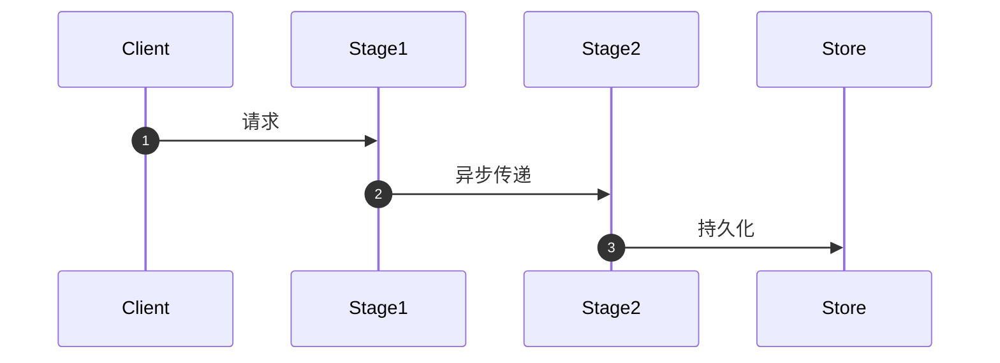

# 主题名称
> **定位与目标**：说明本文解决的核心工程问题或核心理论突破。  
> **核心痛点**：总结在何种极端条件/高并发/复杂约束下会出现此问题。

---

## 目录
- [一、 痛点背景与本质矛盾](#一-痛点背景与本质矛盾)
- [二、 业界主流解法与权衡对比](#二-业界主流解法与权衡对比)
- [三、 核心架构设计与时序图解](#三-核心架构设计与时序图解)
- [四、 工业级代码实战与关键落地](#四-工业级代码实战与关键落地)
- [五、 生产级避坑指南与极限调优](#五-生产级避坑指南与极限调优)
- [六、 认知更新与自我拷问 (Self-Grilling)](#六-认知更新与自我拷问-self-grilling)

---

## 一、 痛点背景与本质矛盾

### 1.1 场景与指标要求
- 业务环境描述（如：高吞吐低延迟、高并发连接、分布式故障）
- 性能指标或一致性约束

### 1.2 为什么常规/天真方案在此失效？
- 分析常规方案（如全局互斥锁、简易递归、盲目重试）在当前瓶颈下的致命缺陷。

---

## 二、 业界主流解法与权衡对比

| 方案路线 | 代表项目/工程 | 核心工作原理 | 性能 / 延迟 | 内存开销 | 核心优劣与适用边界 |
| :--- | :--- | :--- | :--- | :--- | :--- |
| **路线 A** | 例如 DPDK / Linux | ... | ... | ... | ... |
| **路线 B** | 例如 Netty / VPP | ... | ... | ... | ... |
| **路线 C** | 例如 Seastar | ... | ... | ... | ... |

---

## 三、 核心架构设计与时序图解

### 3.1 核心设计哲学
- 阐明核心设计原则（如：Shared-Nothing、Batching、Epoch 隔离、FIFO 排空等）。

### 3.2 架构拓扑或时序图


---

## 四、 工业级代码实战与关键落地

### 4.1 数据结构定义（注重 Cache-Line 对齐与内存排布）
```cpp
// 核心数据结构，注重 false sharing 与内存屏障
```

### 4.2 核心算法/快路径逻辑
```cpp
// Fast path 零阻塞核心实现
```

---

## 五、 生产级避坑指南与极限调优

1. **陷阱 1**：...
2. **陷阱 2**：...
3. **调优要点**：CPU 亲和性绑定、流水线指令优化、内存屏障选择等。

---

## 六、 认知更新与自我拷问 (Self-Grilling)

- [ ] **灵魂拷问 1**：如果系统遇到 ... 极端边界情况，当前设计会不会崩盘？如何降级？
- [ ] **灵魂拷问 2**：为什么此处不选用 ... 方案？在什么规模下当前架构需要重构？
- [ ] **我的 3 条认知更新**：
  1. ...
  2. ...
  3. ...
